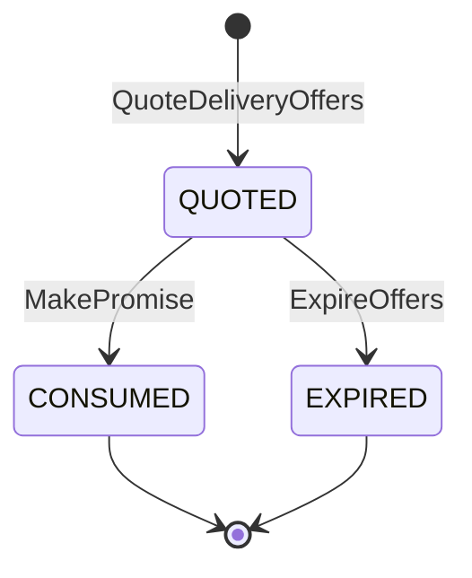
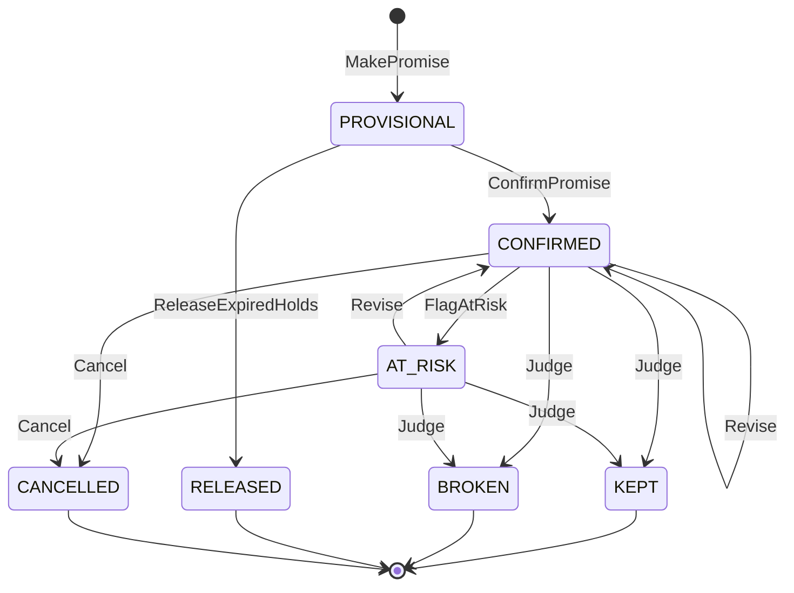
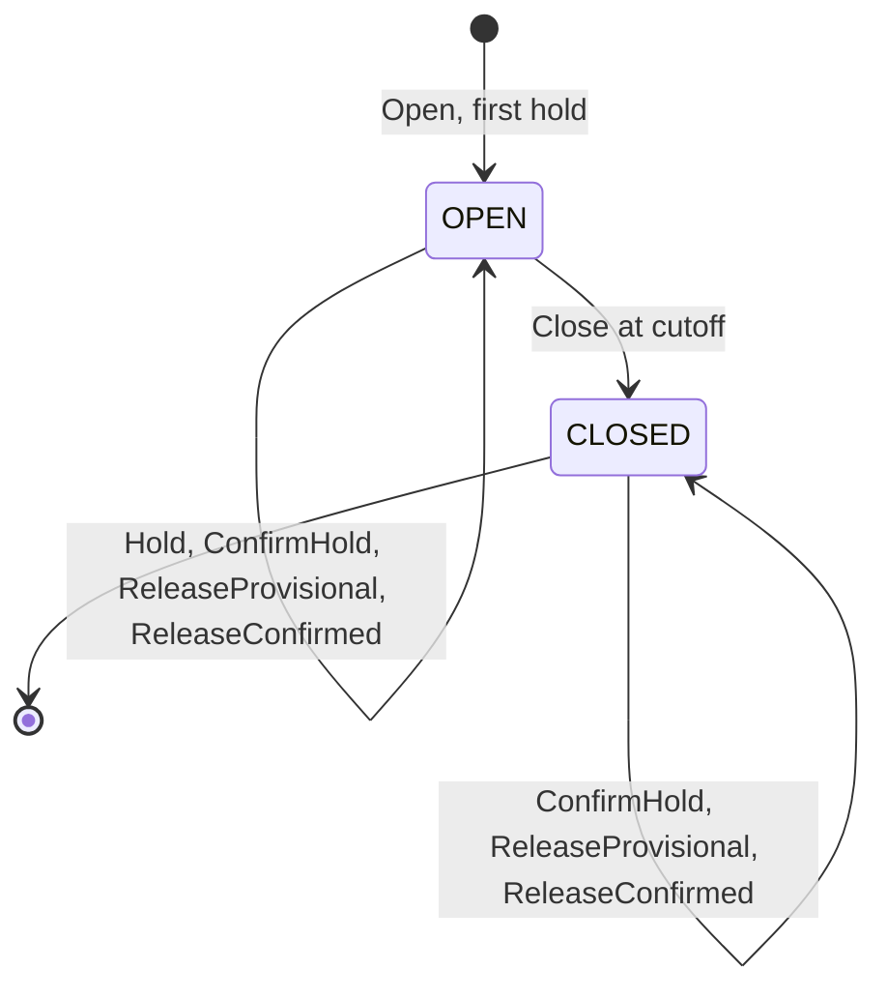

# Aggregate design canvas

Following the ddd-crew [Aggregate Design Canvas v1.1](https://github.com/ddd-crew/aggregate-design-canvas). The context has four aggregate roots, deliberately small: a promise does not contain its book and a book does not list its promises, because one book is shared by every promise on the same node pickup cutoff and is the most contended row. All four are persisted as a jsonb snapshot with an optimistic `version` (policies are append-only versions) and validated by `Restore()`.

## DeliveryOffer

Source: `internal/domain/offer/offer.go`, table `delivery_offers`.

**Description.** A short-lived quote for one shipment group at one tier, with the delivery window, the witness path that proves it, the basis and the policy version. It is the result of the search, persisted with a TTL so checkout can honour exactly the window the shopper saw. It holds no capacity. Value objects: `Window{earliest, latest, timeZone}`, `Witness{nodeId, pickupDepartureId, legs[], deliveryWaveId}`, `Line{catalogItemId, quantity}`.

Source: `internal/domain/offer/offer.go` (`Consume`, `Expire`).

| Canvas item | Content |
| --- | --- |
| Invariants | `expiresAt` is at most the earlier of `quotedAt + offerTtl` and the latest instant the witness pickup cutoff can still be met (`ErrOfferExpiryTooLate`, never returned over HTTP); an expired or consumed offer cannot back a promise (`ErrOfferNotQuotable`); a fast tier is never `NOMINAL` (`ErrNominalBasisNotAllowedForTier`) |
| Corrective policies | `ExpireOffers` sweep; `Quotable(now)` also treats an offer past `expiresAt` as not quotable before the sweep reaches it; checkout re-quotes when `offer-not-quotable` |
| Commands | `QuoteDeliveryOffers` (creates), `MakePromise` (consumes), `ExpireOffers` |
| Events | `DeliveryOfferQuoted` (analytics only), one per persisted offer |
| Throughput and size | highest volume of the context (every product page and cart view), insert-only apart from one terminal transition; a partial index serves the expiry sweep; offers are kept for a retention period after expiry |

## Promise

Source: `internal/domain/promise/promise.go`, table `promises`.

**Description.** The network's commitment for one shipment group of one customer order: tier, ship-by at the witness node, deliver-by window, witness path, basis and policy version. Created `PROVISIONAL` with a capacity hold, `CONFIRMED` when the order is placed, possibly `AT_RISK` and revised, and finally judged `KEPT` or `BROKEN`, or `RELEASED` or `CANCELLED`. Value objects: `Terms`, `Revision{no, previousTerms, reason, revisedAt}`, `Judgement{outcome, deliveredAt, lateByMinutes, cause, judgedAt}`.

Source: `internal/domain/promise/promise.go` (header comment and `Confirm`, `FlagAtRisk`, `Revise`, `Judge`, `Cancel`, `ReleaseExpiredHold`). `MarkUnkeepable` sets a flag on an `AT_RISK` promise and does not change state.

| Canvas item | Content |
| --- | --- |
| Invariants | `deliverByEarliest <= deliverByLatest` and `shipBy < deliverByEarliest` (`ErrInvalidPromiseTerms`); fast tiers are `SCHEDULED` (`ErrNominalBasisNotAllowedForTier`); confirm only before `holdExpiresAt` (`ErrPromiseHoldExpired`); a revision never moves `deliverByLatest` earlier (`ErrRevisionMovesEarlier`); `KEPT`, `BROKEN`, `RELEASED`, `CANCELLED` are terminal (`ErrPromiseClosed`); every line shippable from the witness node (`ErrGroupSpansNodes`); a `PROVISIONAL` promise has no order, judgement or revision; `atRiskReason` is set exactly while `AT_RISK`; a `KEPT` judgement has a delivery and no cause; at most one live promise per order group (partial unique index) |
| Corrective policies | `ReleaseExpiredHolds` sweep; `RepromiseOnRisk` (flag at risk then `ReviseAtRisk`, retried by `RepriceAtRisk`); `JudgeOnDelivery`; cancellation on `CustomerOrderCancelled` or `POST /promises/{promiseId}/cancellations` |
| Commands | `MakePromise`, `ConfirmPromise` (idempotent), `FlagAtRisk`, `Revise`, `MarkUnkeepable`, `Judge`, `Cancel`, `ReleaseExpiredHold` |
| Events | `PromiseMade`, `PromiseConfirmed`, `PromiseAtRisk`, `PromiseRevised`, `PromiseUnkeepable`, `PromiseKept`, `PromiseBroken`, `PromiseReleased`, `PromiseCancelled`; every transition raises exactly one event, a repeat confirm raises none |
| Throughput and size | one row per shipment group, written a few times over its life; contention on one promise is rare (a re-promise racing a judgement) and resolved by the `version` check |

## PromiseBook

Source: `internal/domain/book/book.go`, table `promise_books`.

**Description.** The promise-side capacity ledger of one node pickup cutoff, `bookId = nodeId:pickupDepartureId`: how many orders have been promised onto it against the node's declared `share`. It counts orders, not packages (packages on the truck belong to linehaul's departure). Value object: capacity `{share, provisional, confirmed}`, with `cutoffAt` and `holdDeadline`.

Source: `internal/domain/book/book.go`.

| Canvas item | Content |
| --- | --- |
| Invariants | `provisional + confirmed <= share` (`ErrPromiseCapacityExhausted`); no hold once the book is `CLOSED` or after `cutoffAt` minus handling time (`ErrBookClosed`); a release or confirm never makes a counter negative (`ErrCapacityUnderflow`, internal guard). Confirming and releasing stay legal on a `CLOSED` book so an in-flight confirm never fails for the clock (ADR 0002 A13) |
| Corrective policies | holds expire through `ReleaseExpiredHolds`; the clock closes books at `cutoffAt` (`CloseBooks`); `PromiseBookExhausted` is the signal when a hold fills the book; a full book is not a dead end: the search moves to the next pickup of the node or another node |
| Commands | `Open` (lazily, by the first hold, in the same transaction), `Hold`, `ConfirmHold`, `ReleaseProvisional`, `ReleaseConfirmed`, `Close` |
| Events | `PromiseBookExhausted` when a hold brings `provisional + confirmed` to `share` |
| Throughput and size | high and contended: every checkout for the same node and cutoff writes the same row; three integers and a state per row |

## PromisePolicy

Source: `internal/domain/policy/policy.go`, table `promise_policies`.

**Description.** A versioned set of promise parameters: offer and hold lifetimes (1 to 1440 minutes), packages per order (1 to 100), the share of node capacity the promise side may use (1 to 100 percent) and at most 200 per-tier, per-region local order deadlines. A published version is immutable; the current policy is the highest version and version 0 is the built-in default (10, 15, 1, 100, no deadlines). It has no state machine: `Publish(current, input, now)` returns the next version (`ErrVersionNotNext` otherwise, answered as `concurrent-update`) and raises `PromisePolicyPublished`.

## Read models

Not aggregates: this context enforces no invariant on them, never changes them by command, and their owner can overwrite any row. The search reads them; the aggregates never contain them. All are tables `rm_*` written by `internal/application/usecases/projections.go`.

| Read model (tables) | Source events | Used for |
| --- | --- | --- |
| nodes and profile (`rm_nodes`) | `NodeRegistered`, `NodeOperationalProfileDeclared`, `NodeActivated`, `NodeSuspended`, `NodeRetired` | candidate nodes, `readyAt`, cutoffs, book share |
| regions and service areas (`rm_regions`, `rm_areas`) | `RegionDefined`, `ServiceAreaAssigned` | destination prefix to delivery station and region |
| lanes (`rm_lanes`) | `LaneOpened`, `LaneClosed` | nominal transit for the `STANDARD` fallback |
| availability (`rm_items`, `rm_listings`) | catalogue item and listing events | which nodes can ship each line |
| departures (`rm_departures`) | `DepartureScheduled`, `DepartureCapacityChanged`, `DepartureCancelled` | pickup departures and the path graph with remaining packages |
| waves (`rm_waves`) | `DeliveryWaveScheduled`, `DeliveryWaveCapacityChanged`, `DeliveryWaveCancelled` | the last leg and the promise window |
| scorecards (`rm_scorecards`) | `NodeScorecardUpdated` | the `ScorecardHandicap` |
| shipment facts (`rm_assignments`, `rm_shipments`, `rm_trackings`, `rm_outcomes`) | order-sourcing and shipping-and-tracking events | finding a promise's assignment and judging it |

`rm_departures` says how many **packages** a truck can still take; the book says how many **orders** were promised onto the node's cutoff. The two can disagree, and the search requires both to have room.
