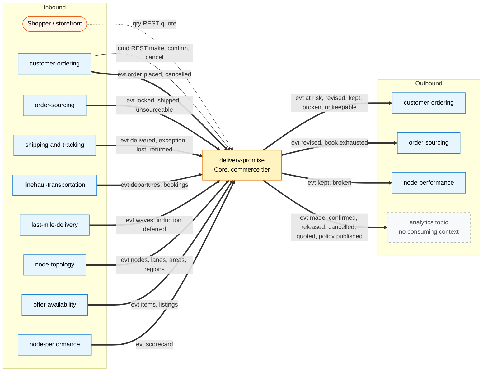

# Bounded context canvas

Following the ddd-crew [Bounded Context Canvas v5](https://github.com/ddd-crew/bounded-context-canvas). Every message row below is backed by code on this branch: `internal/adapters/inbound/kafka/dispatch.go` (consumed), `internal/adapters/outbound/kafka/encoder.go` and `apis/asyncapi.yaml` (published), `apis/openapi.yaml` (REST).

Source: `internal/adapters/inbound/kafka/dispatch.go`, `internal/adapters/outbound/kafka/encoder.go`, `apis/openapi.yaml`, `apis/asyncapi.yaml`. Solid arrows are commands, dotted queries, thick events.

## Name

**Delivery Promise** (`delivery-promise`, CloudEvents tier `commerce`, network area).

## Purpose

Tell a shopper, before and at purchase, the date a package will arrive, and make that date true by construction: quote only from a feasible **witness path** (node cutoff, scheduled departures, delivery wave) with remaining capacity; hold that capacity on the witness node's pickup cutoff until the order is placed or the hold expires; revise a broken promise only to a later window; judge every promise kept or broken at delivery.

## Strategic classification

| Axis | Verdict |
| --- | --- |
| Domain | **Core** ([reasoning](/docs/ddd/subdomain-classification), [chart](/docs/ddd/core-domain-chart)) |
| Business model | Revenue generator (a credible early date converts) and cost reducer (no promise the network cannot keep) |
| Evolution | Custom-built |

## Domain roles

| Role | Applies | Evidence |
| --- | --- | --- |
| Execution (promising) | **Primary** | `MakePromise`, `ConfirmPromise`, `ReviseAtRisk`, `judge`; the `Promise` lifecycle |
| Analysis (feasibility search) | Yes | `QuoteDeliveryOffers`, `internal/domain/search` |
| Enforcer (capacity holds) | Yes | `PromiseBook`: `provisional + confirmed <= share`; `ReleaseExpiredHolds` |
| Gateway / ACL | No | It conforms to each upstream's published language and translates nothing at its boundary |
| Specification | No | It publishes promise facts, not capability specifications |

## Inbound communication

| Collaborator | Message | Type | Channel | Relationship |
| --- | --- | --- | --- | --- |
| Shopper / storefront (shopping-cart, storefront-bff) | quote | Query | REST `POST /delivery-offers:quote` | Open Host |
| customer-ordering | quote, make, confirm, cancel | Query, commands | REST `POST /delivery-offers:quote`, `POST /promises`, `:confirm`, `:cancel` | Customer/Supplier (this context supplies) |
| customer-ordering | `CustomerOrderPlaced`, `CustomerOrderCancelled` | Events | `retailnetwork.customer-ordering.events` | Customer/Supplier |
| order-sourcing | `FulfillmentLocked`, `FulfillmentShipped`, `FulfillmentUnsourceable` | Events | `retailnetwork.order-sourcing.events` | Customer/Supplier |
| shipping-and-tracking | `PackageDelivered`, `PackageExceptionRaised`, `PackageLost`, `PackageReturned` | Events | `retailnetwork.shipping-and-tracking.events` | Conformist |
| linehaul-transportation | `DepartureScheduled`, `DepartureCapacityChanged`, `DepartureCancelled`, `BookingMoved`, `BookingFailed` | Events | `retailnetwork.linehaul-transportation.events` | Conformist |
| last-mile-delivery | `DeliveryWaveScheduled`, `DeliveryWaveCapacityChanged`, `DeliveryWaveCancelled`, `PackageInductionDeferred` | Events | `retailnetwork.last-mile-delivery.events` | Conformist |
| node-topology | `NodeRegistered`, `NodeOperationalProfileDeclared`, `NodeActivated`, `NodeSuspended`, `NodeRetired`, `LaneOpened`, `LaneClosed`, `ServiceAreaAssigned`, `RegionDefined` | Events | `retailnetwork.node-topology.events` | Conformist |
| offer-availability | `CatalogItemCreated`, `CatalogItemDiscontinued`, `ListingCreated`, `ListingAvailabilityChanged`, `ListingSuppressed`, `ListingRestored` | Events | `retailnetwork.offer-availability.events` | Conformist |
| node-performance | `NodeScorecardUpdated` | Event | `retailnetwork.node-performance.events` | Conformist |
| agents, console | the REST reads, five MCP tools, two A2A skills | Queries | REST GET, MCP, A2A | none negotiated |

34 consumed types in total. The relationship column states the pattern the aggregator's model assigns; this repository only records that it conforms to each upstream vocabulary (tolerant local copies in `apis/asyncapi.yaml`).

## Outbound communication

| Collaborator | Message | Channel |
| --- | --- | --- |
| customer-ordering | `PromiseAtRisk`, `PromiseRevised`, `PromiseKept`, `PromiseBroken`, `PromiseUnkeepable` | `retailnetwork.delivery-promise.events` |
| order-sourcing | `PromiseRevised`, `PromiseBookExhausted` | same topic |
| node-performance | `PromiseKept`, `PromiseBroken` | same topic |
| none | `PromiseMade`, `PromiseConfirmed`, `PromiseReleased`, `PromiseCancelled`, `DeliveryOfferQuoted`, `PromisePolicyPublished` | `retailnetwork.delivery-promise.analytics` |
| (synchronous calls) | none | the promise hot path calls no sibling |

## Ubiquitous language

Full glossary: [Ubiquitous language](/docs/ddd/ubiquitous-language). Core terms: Delivery Offer, Service Tier, Promise, Ship-By, Deliver-By Window, Witness Path, Promise Basis, Promise Book, Capacity Hold, Handicap, Re-promise, Promise Kept or Broken, Shipment Group.

## Business decisions

1. **No path, no offer.** A tier with no feasible witness path returns no offer and the constraint that blocked it.
2. **Fast tiers are never quoted from nominal times.** Only `STANDARD` may fall back to nominal lane transit and then records basis `NOMINAL`.
3. **A promise holds capacity** on the witness node's pickup cutoff; provisional holds expire (`holdTtlMinutes`).
4. **One promise per shipment group.** The cart is grouped onto the fewest nodes (`ErrGroupSpansNodes` guards a group).
5. **Handicap, never silent exclusion.** A weak node's ship-by moves later by its scorecard grade.
6. **Kept means on time**: delivered on or before `deliverByLatest`; a lost or returned package breaks the promise.
7. **Dates only move later**: a revision never moves `deliverByLatest` earlier.
8. **Peak control by deadline**: per tier and region, a policy-versioned local order deadline stops quoting that tier (`PAST_ORDER_DEADLINE`).

## Assumptions

- Upstream events arrive within seconds; the read models are only as fresh as the slowest topic, so a stale departure row can be quoted and is refused at `MakePromise` revalidation as a full book.
- `linehaul-transportation` publishes departures ahead (a pickup departure per declared cutoff of every active vendor node) and `last-mile-delivery` publishes waves for every delivery station with a service area; without them there is no witness path.
- Every destination postal prefix maps to one delivery station (`rm_areas`).
- Customer-ordering normally confirms before the hold expires; the hold is a guard, not the main path.

## Verification metrics

| Metric | Definition | Source |
| --- | --- | --- |
| Promise-kept rate | `PromiseKept / (PromiseKept + PromiseBroken)` per tier | events topic |
| Re-promise rate | `PromiseRevised / PromiseConfirmed` | events and analytics topics |
| Hold leakage | `PromiseReleased / PromiseMade` | analytics topic |
| Make outcomes | `promising.promises.made` by `outcome` and `reason` | OpenTelemetry, dashboard `warehouse-delivery-promise` |
| Request duration | `http.server.request.duration` by route | OpenTelemetry |
| Outbox backlog | `SELECT count(*) FROM outbox_events WHERE published_at IS NULL` | Postgres (no metric exists) |
| Book exhaustion | `PromiseBookExhausted` per node per day | events topic |

## Open questions and known discrepancies

Recorded from the code, not decided here:

1. **Lost packages are judged.** The aggregator's model treated `PackageLost` and `PackageReturned` as analytics-only; the service consumes both and judges the group `BROKEN` with cause `LOST` or `RETURNED` (`internal/application/usecases/judge.go`).
2. **Cancelled waves are handled.** `DeliveryWaveCancelled` marks the wave cancelled and flags promises whose witness wave it is (`OnWaveCancelled`).
3. **Unkeepable promises stay `AT_RISK`.** `PromiseUnkeepable` is raised once and `RepriceAtRisk` keeps retrying; customer-ordering is expected to cancel the group, which then cancels the promise.
4. **Problem slugs.** The aggregator's pack names `offer-not-found`, `promise-not-found`, `invalid-request` and `stale-write`; the service answers `not-found` (404), `validation-failed` (422), `malformed-request` (400) and `concurrent-update` (409).
5. **The first-line spec text** of `apis/openapi.yaml` still cites `retail-network-docs model/model.yaml`, a renamed repository.
6. **Alert runbook links** in `warehouse-infra` still point at the pre-move `docs/operations/runbook.md`.
