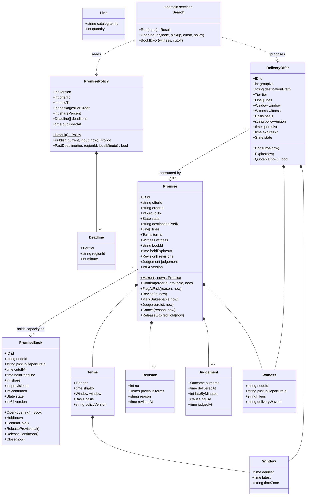
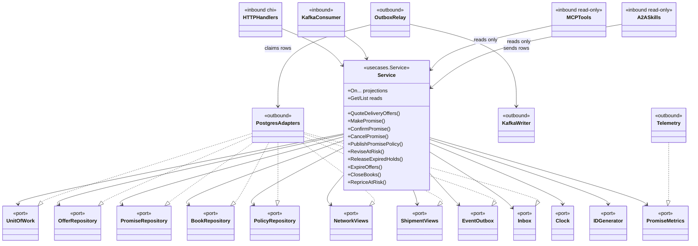

# Class diagram

Two views: the domain model (`internal/domain`) and the ports and adapters around the use cases.

## Domain model

Source: `internal/domain/offer/offer.go`, `internal/domain/promise/promise.go`, `internal/domain/book/book.go`, `internal/domain/policy/policy.go`, `internal/domain/search`, `internal/domain/shared`.

Enumerations: `Tier` (`SAME_DAY`, `NEXT_DAY`, `TWO_DAY`, `STANDARD`; only `STANDARD` allows a `NOMINAL` basis), `Basis` (`SCHEDULED`, `NOMINAL`), offer `State` (`QUOTED`, `EXPIRED`, `CONSUMED`), promise `State` (`PROVISIONAL`, `CONFIRMED`, `AT_RISK`, `KEPT`, `BROKEN`, `RELEASED`, `CANCELLED`), book `State` (`OPEN`, `CLOSED`), `Outcome` (`KEPT`, `BROKEN`), `Cause` (`LATE`, `LOST`, `RETURNED`). Each aggregate has a `Snapshot` and a `Restore` that validates every invariant (`shared.Corrupt` otherwise). Domain events (`PromiseMade`, `PromiseConfirmed`, `PromiseAtRisk`, `PromiseRevised`, `PromiseKept`, `PromiseBroken`, `PromiseReleased`, `PromiseCancelled`, `PromiseUnkeepable`, `PromiseBookExhausted`, `DeliveryOfferQuoted`, `PromisePolicyPublished`) are returned by the commands and appended to the outbox by the use case.

## Ports and adapters

Source: `internal/application/usecases/service.go` (`Deps`), `internal/application/ports`, `cmd/api/main.go`, `cmd/api/workers.go`, `internal/adapters/**`. `Clock` and `IDGenerator` are implemented by `outbound/clock` and `outbound/ids`; `cmd/mcp` and `cmd/a2a` construct the same `Service` with a `Reads`-only facade, so neither can reach a write method.
