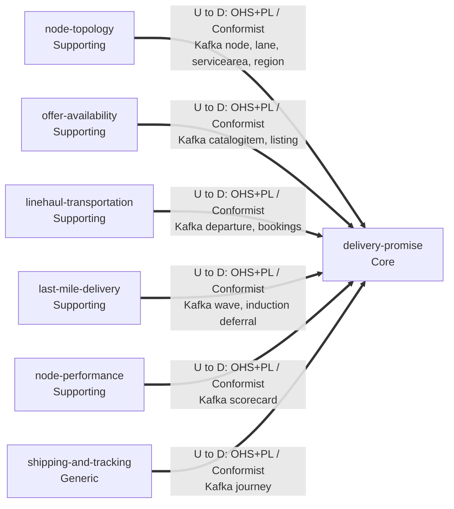
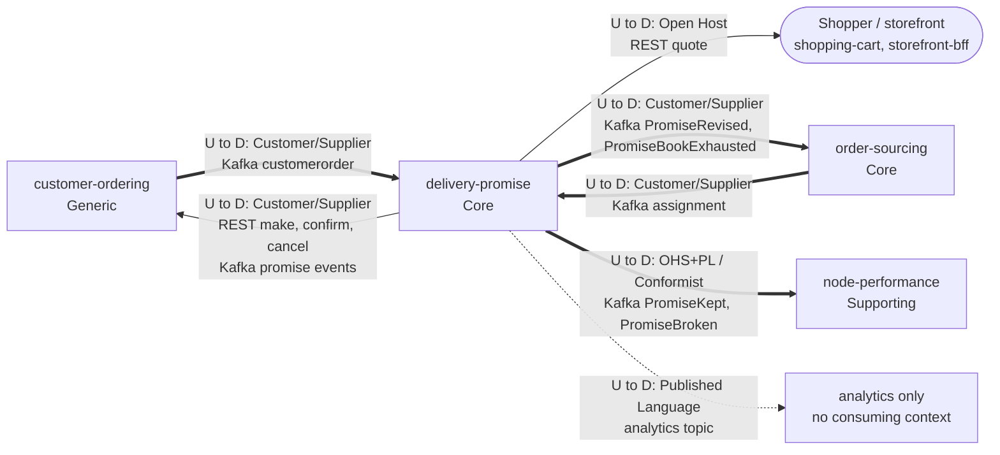

# Context map

Following ddd-crew [Context Mapping](https://github.com/ddd-crew/context-mapping). This is Delivery Promise's slice of the retail-network map ([the domain context map](https://iqvo.github.io/warehouse-docs/network/strategic-design/context-map) on the aggregator): every relationship, with upstream (U) and downstream (D) side, pattern and channel. The patterns are the aggregator model's classification; the channels and messages were checked against this repository's code and the neighbours' `origin/develop`.

Delivery Promise is **downstream of the data owners** it builds local read models from, and **upstream of the contexts that act on a promise**. `customer-ordering` and `order-sourcing` are both: one relationship per message flow.

## Upstream: the data the promise is built from

Source: `internal/adapters/inbound/kafka/dispatch.go` (`Handlers`).

## Partners in the order flow, and downstream

Source: `apis/openapi.yaml`, `apis/asyncapi.yaml`, and the consumers' `handlers.go` on `origin/develop` (customer-ordering, order-sourcing, node-performance).

Legend: `==>` event flow over Kafka, `-->` synchronous REST (the arrow points from the server, the upstream, to the caller), `-.->` published with no consuming context. Omitted: Postgres and Kafka themselves.

## Relationships

| Neighbour | Direction | Pattern | Channel | Messages | Why |
| --- | --- | --- | --- | --- | --- |
| node-topology (Supporting) | U to D (this context downstream) | OHS + PL / Conformist | Kafka `retailnetwork.node-topology.events` | `NodeRegistered`, `NodeOperationalProfileDeclared`, `NodeActivated`, `NodeSuspended`, `NodeRetired`, `LaneOpened`, `LaneClosed`, `ServiceAreaAssigned`, `RegionDefined` | Master data with many consumers; taken as published into `rm_nodes`, `rm_lanes`, `rm_areas`, `rm_regions` |
| offer-availability (Supporting) | U to D | OHS + PL / Conformist | Kafka `retailnetwork.offer-availability.events` | `CatalogItemCreated`, `CatalogItemDiscontinued`, `ListingCreated`, `ListingAvailabilityChanged`, `ListingSuppressed`, `ListingRestored` | availability per listing used as published, never re-derived |
| linehaul-transportation (Supporting) | U to D | OHS + PL / Conformist | Kafka `retailnetwork.linehaul-transportation.events` | `DepartureScheduled`, `DepartureCapacityChanged`, `DepartureCancelled`, `BookingMoved`, `BookingFailed` | departures are the edges of the search graph; cancelled, moved or failed ones put promises at risk |
| last-mile-delivery (Supporting) | U to D | OHS + PL / Conformist | Kafka `retailnetwork.last-mile-delivery.events` | `DeliveryWaveScheduled`, `DeliveryWaveCapacityChanged`, `DeliveryWaveCancelled`, `PackageInductionDeferred` | waves give the promise window and stop capacity |
| node-performance (Supporting) | U to D | OHS + PL / Conformist | Kafka `retailnetwork.node-performance.events` | `NodeScorecardUpdated` | the grade is used as published; the handicap rule is this context's own |
| shipping-and-tracking (Generic) | U to D | OHS + PL / Conformist | Kafka `retailnetwork.shipping-and-tracking.events` | `PackageDelivered`, `PackageExceptionRaised`, `PackageLost`, `PackageReturned` | package facts drive judgement and risk |
| customer-ordering (Generic) | this context U, CO D | Customer/Supplier (CO is the Customer) | REST `POST /promises`, `/confirmations`, `/cancellations`; Kafka `retailnetwork.delivery-promise.events` | make, confirm, cancel; `PromiseAtRisk`, `PromiseRevised`, `PromiseKept`, `PromiseBroken`, `PromiseUnkeepable` | checkout needs an answer inside the shopper's request; CO's order status depends on promise changes. Verified in customer-ordering's gateway and Kafka handlers |
| customer-ordering (Generic) | CO U, this context D | Customer/Supplier | Kafka `retailnetwork.customer-ordering.events` | `CustomerOrderPlaced`, `CustomerOrderCancelled` | placing the order confirms provisional promises; cancelling releases them |
| order-sourcing (Core) | OS U, this context D | Customer/Supplier | Kafka `retailnetwork.order-sourcing.events` | `FulfillmentLocked`, `FulfillmentShipped`, `FulfillmentUnsourceable` | an unsourceable group comes back to re-promise; sourcing never breaks a promise silently |
| order-sourcing (Core) | this context U, OS D | Customer/Supplier | Kafka `retailnetwork.delivery-promise.events` | `PromiseRevised`, `PromiseBookExhausted` | a revised window changes the sourcing constraint; an exhausted book raises the cost of that cutoff. Verified in order-sourcing's `handlers.go` |
| Shopper / storefront (shopping-cart, storefront-bff) | this context U | Open Host | REST `POST /delivery-quotes` | quote | any client may ask for a quote; no contract is negotiated per client. Verified in both clients' allowlists |
| node-performance (Supporting) | this context U, NP D | OHS + PL / Conformist | Kafka `retailnetwork.delivery-promise.events` | `PromiseKept`, `PromiseBroken` | NP counts kept and broken promises per node. Verified in node-performance's `handlers.go` |
| analytics (no context) | this context U | Published Language | Kafka `retailnetwork.delivery-promise.analytics` | `PromiseMade`, `PromiseConfirmed`, `PromiseReleased`, `PromiseCancelled`, `DeliveryOfferQuoted`, `PromisePolicyPublished` | published for the record; no consumer found |
| warehouse-ops-agent | this context U | read-only MCP | `/mcp` on `delivery-promise-mcp:8090` | five tools | configured in `warehouse-infra` |
| vendor-connectivity (Supporting) | none | Separate Ways | none | none | the vendor side starts after order-sourcing releases a group |
| warehouse-systems fleet | none | Separate Ways (hard boundary) | none | none | no `warehouse.*` topic is read and no fleet service is called; the only seam is the Vendor API, which this context does not use |

## Notes on the patterns

- **Conformist, with no ACL, toward the data owners.** Every upstream publishes the vocabulary this context needs under the same language; the read models store it as published. A Shared Kernel is avoided: `order-sourcing` builds its own network graph from the same events and the two contexts share no code or table.
- **Customer/Supplier, both ways, with the two order-flow contexts.** The contracts were shaped for each other: `PromiseMade`'s fields are what checkout needs, `CustomerOrderPlaced` carries each group's `promiseId`, and `FulfillmentUnsourceable` carries the `promiseId` back. It is not a Partnership: each side releases its half on its own schedule because every message is versioned (`dataschema ...:v1`).
- **No synchronous call out.** Every input of the promise hot path is a local read model. A neighbour that is down slows freshness, not quotes. See [Integration](/docs/ecosystem/integration) for failure behaviour.
