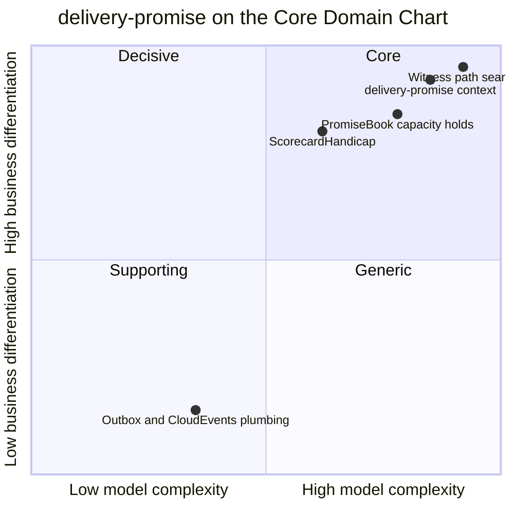

# Core domain chart

Following the ddd-crew [Core Domain Charts](https://github.com/ddd-crew/core-domain-charts): business differentiation (y) against model complexity (x).

Source: positions come from the aggregator's model (`differentiation: 0.92`, `complexity: 0.85` for the context point); the slice positions are an estimate relative to the context point. Code: `internal/domain/search` (search), `internal/domain/book` (capacity), the handicap in `internal/domain/search`, `internal/adapters/outbound/outbox` and `internal/adapters/kafka/cloudevents` (plumbing).

## Classification: Core

The context point and all three differentiating slices sit in quadrant 1 (Core). Business model: revenue generator (a credible early date converts) and cost reducer (no promise the network cannot keep).

### Why differentiation is high

- The promise is the one number every shopper sees before buying. Showing an earlier date than competitors, and keeping it, is the advantage.
- Nothing here can be bought. The search runs on this network's own nodes, cutoffs, departures, waves and grades; a generic carrier transit-time table cannot know that one vendor's 14:00 cutoff is full.
- The rules are policy, not plumbing: the scorecard handicap, the per-tier order deadlines and the shipment grouping are business levers, versioned by `policyVersion` (`internal/domain/policy`).

### Why complexity is high

- The search is a time-expanded earliest-arrival path over scheduled departures with remaining capacity, with sort dwell at every node, operating hours and holidays at the origin and delivery waves at the end (`internal/domain/search`, `internal/domain/calendar`).
- It runs on every quote without a synchronous call, so about a dozen event-fed read models (`rm_*`) must stay fresh enough to be trusted.
- A promise has seven states and must stay consistent with a contended capacity ledger (one `promise_books` row per node cutoff, one hold per promise).
- It must react to seven kinds of breakage (unsourceable group, package exception, deferred induction, cancelled departure, cancelled wave, failed booking, moved booking) without ever moving a date earlier (`ErrRevisionMovesEarlier`).

### The slices

| Slice | Position | Why there |
| --- | --- | --- |
| Witness path search | highest on both axes | The differentiating algorithm; hardest to get right, most valuable. Mutation-tested: the weakest package, `search`, measures 77.78 % efficacy (`.gremlins.yaml`) |
| `PromiseBook` capacity holds | slightly lower | A classic reservation ledger, but on this network's own unit (orders per node cutoff) and contended |
| `ScorecardHandicap` | lower complexity | A small rule table, but it is what makes declared capability honest |
| Outbox, inbox, CloudEvents codec, projectors | bottom left | Commodity plumbing shared by every context |

## Evolution

| Part | Stage | Why |
| --- | --- | --- |
| Witness path search and its constraints | Custom-built | Specific to this network's node types, tiers and read models |
| `PromiseBook` | Custom-built | The unit is this network's |
| Policies (handicap, order deadlines, grouping) | Custom-built, tuned often | Versioned by `policyVersion`; expected to change with peak seasons |
| Plumbing (outbox, inbox, CloudEvents, projectors) | Commodity | The same building blocks every context uses |

**Movement to watch.** If the search proves stable and the network grows a second promise consumer, the read-model projection layer could become a shared network-graph product used by both this context and `order-sourcing`, which each build their own view of the same events today. Nothing in the code proposes it. See also [Subdomain classification](/docs/ddd/subdomain-classification).
