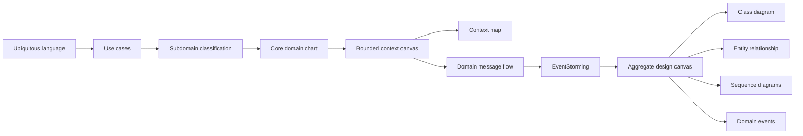

# DDD artifacts (ddd-crew)

The strategic and tactical design of Delivery Promise, one page per [ddd-crew](https://github.com/ddd-crew) artifact. Every page is checked against the code on the branch; where the code disagrees with the aggregator's model, the page says so (see the open questions on the [Bounded context canvas](/docs/ddd/bounded-context-canvas#open-questions-and-known-discrepancies)). All names in the domain are synthetic, see the README disclaimer. Start with the [Ubiquitous language](/docs/ddd/ubiquitous-language), the [Use cases](/docs/ddd/use-cases) and the [Subdomain classification](/docs/ddd/subdomain-classification).

| Artifact | Page | Answers |
| --- | --- | --- |
| Core Domain Chart | [Core domain chart](/docs/ddd/core-domain-chart) | Why this context is Core and which slices deserve the most care |
| Bounded Context Canvas | [Bounded context canvas](/docs/ddd/bounded-context-canvas) | Purpose, roles, messages in and out, decisions, metrics, open questions |
| Context Mapping | [Context map](/docs/ddd/context-map) | Upstream, downstream and pattern of every relationship |
| Aggregate Design Canvas | [Aggregate design canvas](/docs/ddd/aggregate-design-canvas) | Invariants, state machines, commands and events of the four aggregates |
| Domain Message Flow Modelling | [Domain message flow](/docs/ddd/domain-message-flow) | The four business scenarios across contexts |
| EventStorming | [EventStorming](/docs/ddd/eventstorming) | Process-level boards with policies and hotspots |
| Class diagram | [Class diagram](/docs/ddd/class-diagram) | The domain model and the ports and adapters |
| Entity relationship | [Entity relationship](/docs/ddd/entity-relationship) | The Postgres tables, indexes and read models |
| Sequence diagrams | [Sequence diagrams](/docs/ddd/sequence-diagrams) | Adapter to aggregate to outbox for each flow |
| Domain events | [Domain events](/docs/ddd/domain-events) | Meaning, raiser and recipients of each event |

## The model in one paragraph

Four aggregates: a short-lived **DeliveryOffer** (a quote with a witness path), the **Promise** (a seven-state commitment with a capacity hold), the **PromiseBook** (the order-count ledger of one node pickup cutoff, shared by many promises) and the versioned **PromisePolicy**. Everything else is a local read model fed by eight Kafka topics, so the quote hot path calls nobody. Twelve events leave through the outbox. The code is in `internal/domain` (pure, no I/O), `internal/application` (use cases and ports) and `internal/adapters`; the architecture fitness tests in `internal/architecture` enforce the dependency direction.

## How the pages relate

Read left to right for the order the artifacts were produced in; the strategic ones (up to the context map) say why, the tactical ones say how.
