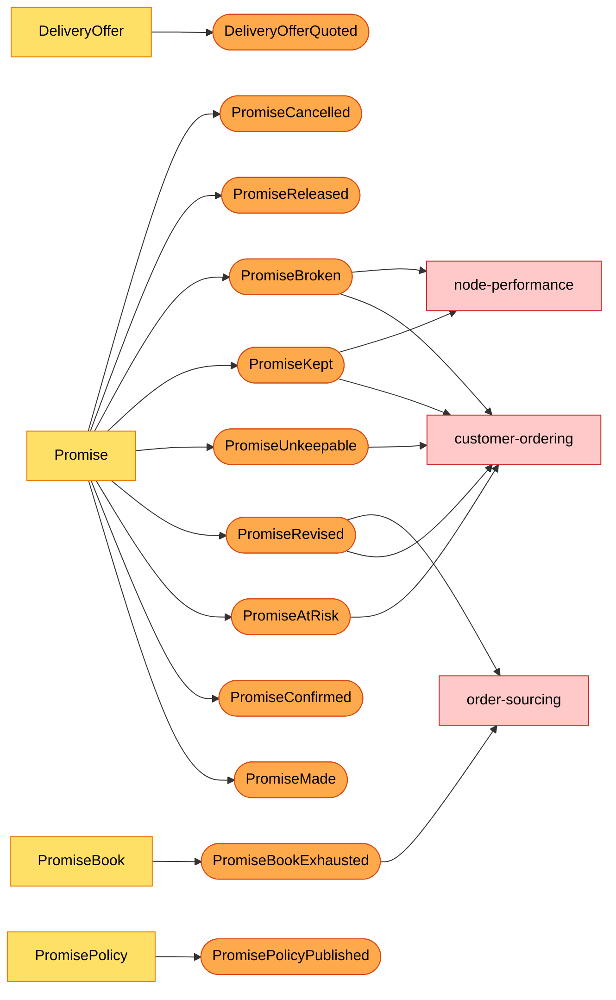

# Domain events

The model view of the events. The wire format, topics, key and payload fields are on the [Event catalogue](/docs/api-reference/events); how a neighbour reacts is on [Integration](/docs/ecosystem/integration). Event names are past tense, raised by an aggregate command and appended to the outbox in the same transaction (`internal/domain/*/events.go`, `internal/adapters/outbound/kafka/encoder.go`).

Source: aggregates `internal/domain/{offer,promise,book,policy}`; consumers verified in `customer-ordering`, `order-sourcing` and `node-performance` (`origin/develop`, `internal/adapters/inbound/kafka/handlers.go`). The analytics events have no consumer and are left out of the arrows.

## Published

| Event | Aggregate | Meaning | Raised by | Recipients |
| --- | --- | --- | --- | --- |
| `DeliveryOfferQuoted` | DeliveryOffer | An offer was persisted with its window and witness. One per offer, so one quote can raise several. | `QuoteDeliveryOffers` | none (analytics: quote-to-order conversion per tier and node) |
| `PromiseMade` | Promise | A provisional promise holds capacity; the offer is consumed. | `MakePromise` | none (analytics) |
| `PromiseConfirmed` | Promise | The order was placed; the hold became confirmed. A repeated confirm raises nothing. | `ConfirmPromise` | none (analytics) |
| `PromiseReleased` | Promise | A provisional promise's hold expired and was returned (`reason: HOLD_EXPIRED`). | `ReleaseExpiredHolds` | none (analytics: hold leakage) |
| `PromiseCancelled` | Promise | A confirmed or at-risk promise was cancelled and its confirmed hold returned. | `CancelPromise`, `OnCustomerOrderCancelled` | none (analytics) |
| `PromiseAtRisk` | Promise | The witness path is no longer feasible (`reason` names why). A signal, not a verdict. | `FlagAtRisk` in `OnDepartureCancelled`, `OnWaveCancelled`, `OnBookingFailed`, `OnBookingMoved`, `OnPackageExceptionRaised`, `OnPackageInductionDeferred`, `OnFulfillmentUnsourceable` | customer-ordering |
| `PromiseRevised` | Promise | The window moved later because the old path broke; carries the previous latest bound and the new terms, node and reason. | `ReviseAtRisk` | customer-ordering, order-sourcing |
| `PromiseUnkeepable` | Promise | Re-promising found no path at any tier. At most once per promise. | `ReviseAtRisk` | customer-ordering |
| `PromiseKept` | Promise | Delivered on or before `deliverByLatest`. | `JudgePromise` | customer-ordering, node-performance |
| `PromiseBroken` | Promise | Delivered late, lost or returned, with cause `LATE`, `LOST` or `RETURNED` and minutes late. | `JudgePromise` | customer-ordering, node-performance |
| `PromiseBookExhausted` | PromiseBook | A hold brought the node's cutoff to its share; later quotes find no room there. | `MakePromise` | order-sourcing |
| `PromisePolicyPublished` | PromisePolicy | A new immutable policy version is current. | `PublishPromisePolicy` | none (analytics) |

Every state change of a promise raises exactly one event, with the single exception of the idempotent repeat of a confirm. The state machine is on [Aggregate design canvas](/docs/ddd/aggregate-design-canvas).

## Consumed

Each consumed event updates a read model (never an aggregate directly) or runs a policy. Idempotent on the CloudEvents `id`.

| Event (producer) | Reaction | Policy or projection |
| --- | --- | --- |
| `NodeRegistered`, `NodeOperationalProfileDeclared`, `NodeActivated`, `NodeSuspended`, `NodeRetired` (node-topology) | upsert the node and profile; a suspended or retired node leaves the candidate set | projection `rm_nodes` |
| `LaneOpened`, `LaneClosed`, `ServiceAreaAssigned`, `RegionDefined` (node-topology) | upsert lane, service area, region | projections |
| `CatalogItemCreated`, `CatalogItemDiscontinued`, `ListingCreated`, `ListingAvailabilityChanged`, `ListingSuppressed`, `ListingRestored` (offer-availability) | upsert item and listing | projections |
| `DepartureScheduled`, `DepartureCapacityChanged` (linehaul) | upsert the departure and its remaining packages | projection `rm_departures` |
| `DepartureCancelled` (linehaul) | mark the departure unscheduled; flag promises whose witness uses it | `RepromiseOnRisk` |
| `BookingMoved`, `BookingFailed` (linehaul) | flag promises that rode the booking | `RepromiseOnRisk` |
| `DeliveryWaveScheduled`, `DeliveryWaveCapacityChanged` (last-mile) | upsert the wave | projection `rm_waves` |
| `DeliveryWaveCancelled` (last-mile) | mark cancelled; flag promises whose witness wave it is | `RepromiseOnRisk` |
| `PackageInductionDeferred` (last-mile) | flag the promise | `RepromiseOnRisk` |
| `NodeScorecardUpdated` (node-performance) | upsert the grade | projection `rm_scorecards` |
| `FulfillmentLocked`, `FulfillmentShipped` (order-sourcing) | record the assignment, then the packages; may complete the facts for judging | `JudgeOnDelivery` |
| `FulfillmentUnsourceable` (order-sourcing) | flag the promise at risk and re-promise excluding the listed nodes | `RepromiseOnRisk` |
| `PackageDelivered`, `PackageLost`, `PackageReturned` (shipping-and-tracking) | record the outcome; judge when complete | `JudgeOnDelivery` |
| `PackageExceptionRaised` (shipping-and-tracking) | flag the promise at risk | `RepromiseOnRisk` |
| `CustomerOrderPlaced` (customer-ordering) | confirm each group's promise if still provisional | reconciling `ConfirmPromise` |
| `CustomerOrderCancelled` (customer-ordering) | cancel the listed groups' promises, or all of them | `CancelPromise` |

Source: `internal/adapters/inbound/kafka/dispatch.go` (`Handlers`), `internal/application/usecases/projections.go`. A payload that cannot be applied is dead-lettered, never blocks the partition.

## Ordering and delivery guarantees

- At-least-once, key = aggregate root id; the relay sends rows in `outbox_events.id` order.
- A promise's events share a partition, so a consumer sees `PromiseAtRisk` before the `PromiseRevised` that follows it.
- Producers are not ordered across topics: the read model keeps what it knows, and a late schedule event never undoes a later cancel (`scheduled` flag handling in `projections.go`).
- No event carries personal data: the destination is a postal prefix and ids only.
