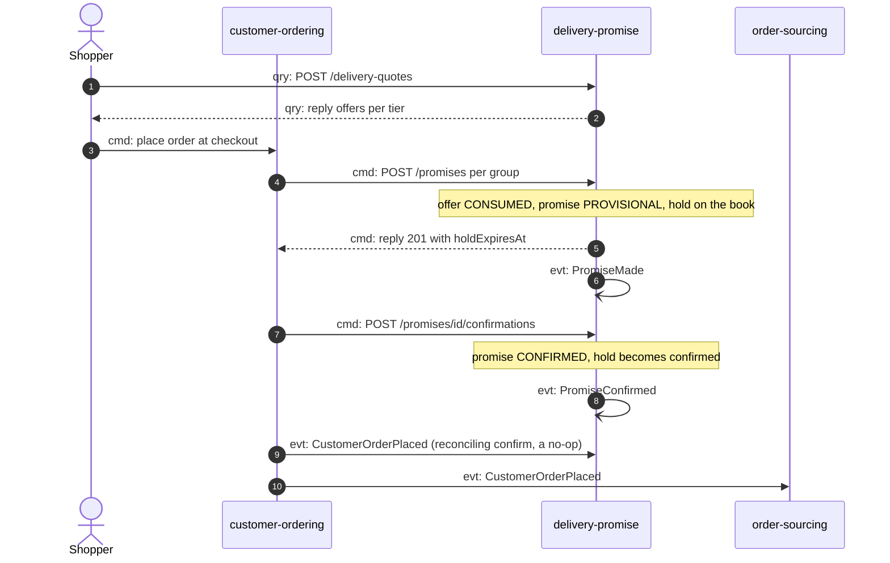
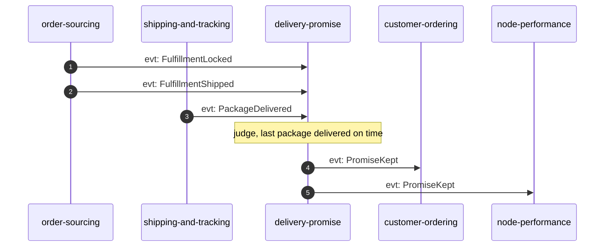
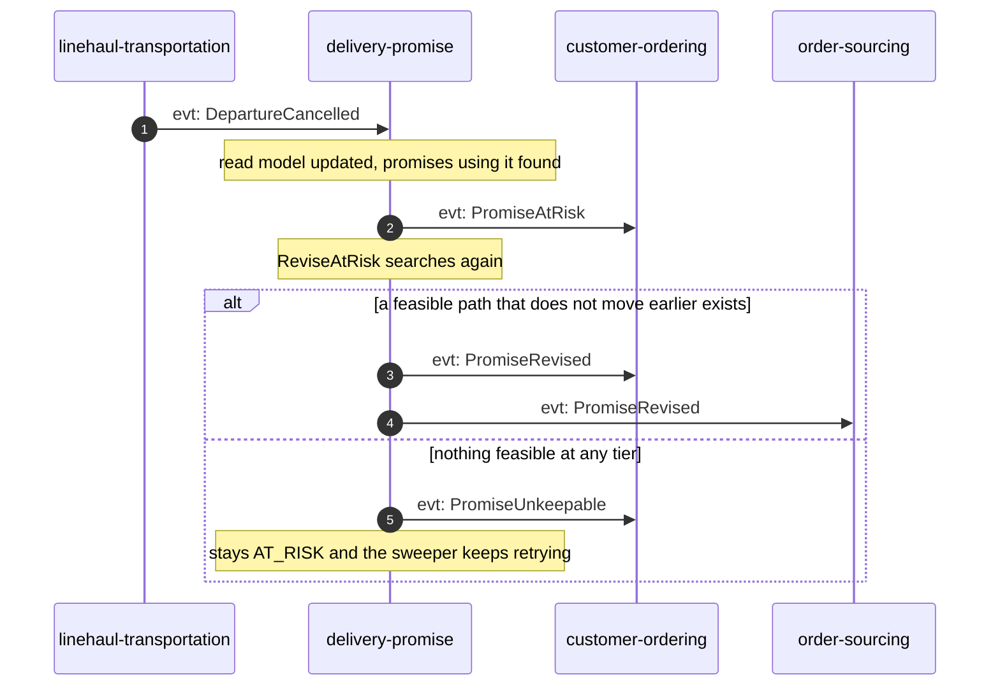
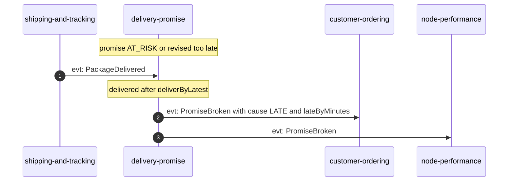
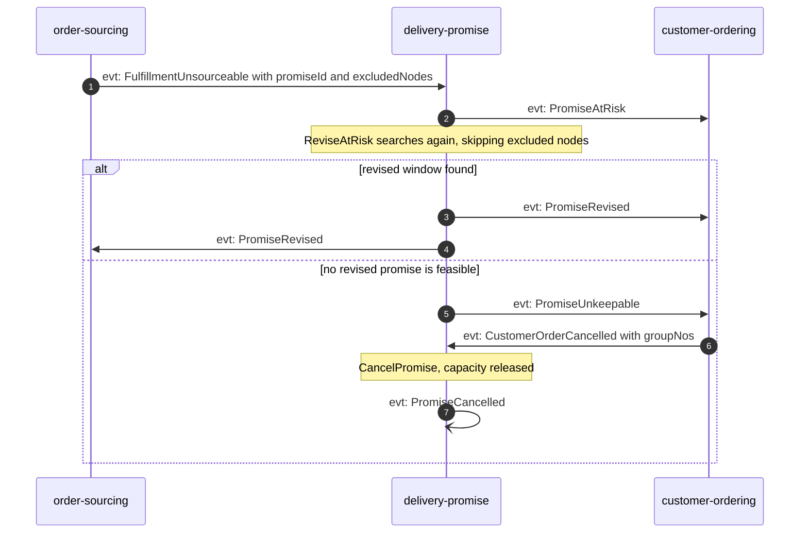
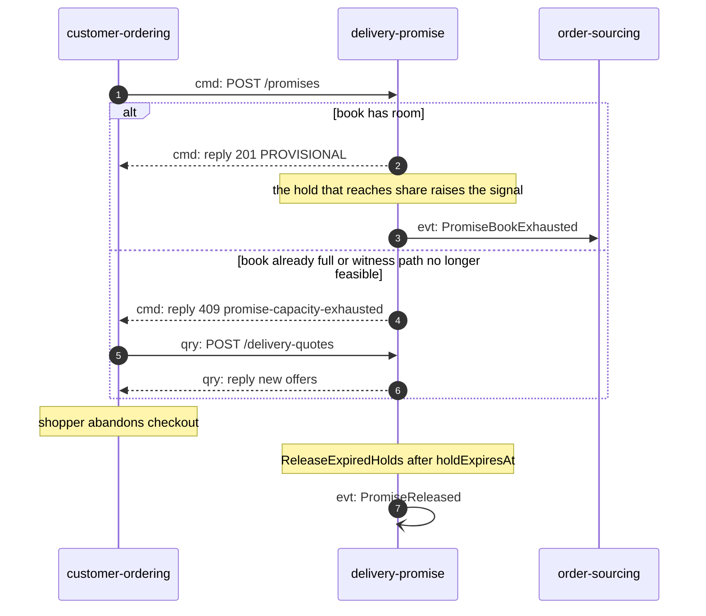

# Domain message flow

Following ddd-crew [Domain Message Flow Modelling](https://github.com/ddd-crew/domain-message-flow-modelling). Participants are bounded contexts and actors. Every arrow is a message prefixed `cmd:` (command), `qry:` (query) or `evt:` (event). Events travel over Kafka through each producer's outbox; the diagrams draw them straight from producer to consumer. A self-arrow on `delivery-promise` marks an event published with no consuming context (analytics only). Full event types are on [Domain events](/docs/ddd/domain-events); the internal steps are on [Sequence diagrams](/docs/ddd/sequence-diagrams).

## 1. Quote, promise, confirm, keep (happy path)

### 1a. Quote and checkout

Source: `apis/openapi.yaml`, `internal/application/usecases/make_promise.go`, `lifecycle.go` (`ConfirmPromise`), `projections.go` (`OnCustomerOrderPlaced`).

### 1b. Judged at delivery

Source: `internal/application/usecases/judge.go`. The group is judged only when the lock, the shipment and every delivery are known; the event that completes the facts triggers the judgement, whichever arrives last.

## 2. A cancelled departure breaks the witness path

### 2a. At risk, then revised

Source: `internal/application/usecases/risk.go`, `projections.go` (`OnDepartureCancelled`).

### 2b. Judged broken

Source: `internal/application/usecases/judge.go`. A lost or returned package breaks the promise at once with cause `LOST` or `RETURNED`.

## 3. Order sourcing cannot meet the promise

Source: `projections.go` (`OnFulfillmentUnsourceable`, `OnCustomerOrderCancelled`), `apis/asyncapi.yaml` (`PromiseUnkeepable`: customer-ordering consumes it and cancels the group; its `CustomerOrderCancelled` then cancels the promise).

## 4. A full pickup cutoff, and a hold nobody confirmed

Source: `internal/domain/book/book.go`, `make_promise.go` (`refusal`), `lifecycle.go` (`ReleaseExpiredHolds`). The `book-closed` branch (the cutoff minus handling time has passed) has the same reply shape with `409 book-closed`.
