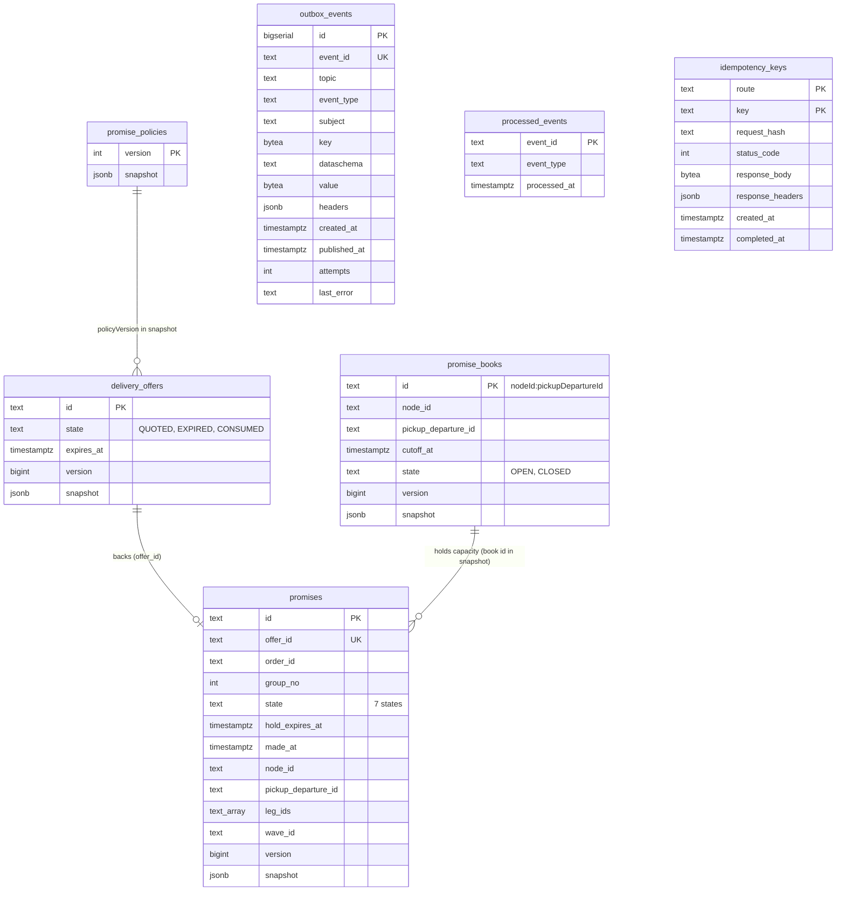
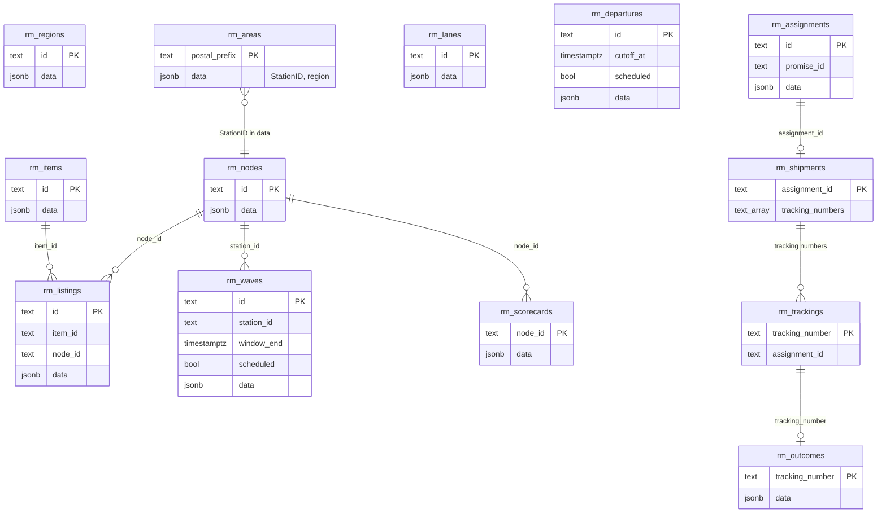

# Entity relationship

The schema is created by two embedded migrations (`internal/adapters/outbound/postgres/migrations/0001_delivery_promise_schema.up.sql`, `0002_window_time_zone.up.sql`). Aggregates are stored as a `jsonb` snapshot that `Restore()` validates on read, with columns beside it for the queries and constraints the use cases need. There are almost no foreign keys: relations between aggregates are by id, and the read models are independent copies of other contexts' facts.

## Aggregates, outbox and inbox

Source: `internal/adapters/outbound/postgres/migrations/0001_delivery_promise_schema.up.sql`, `internal/adapters/outbound/postgres/` (repositories).

- `promises.offer_id` is `UNIQUE`: an offer backs at most one promise. `promises_order_group` is a partial unique index on `(order_id, group_no)` for promises that are not `RELEASED` or `CANCELLED`, so one live promise per order group.
- Partial indexes serve the sweeper and the reactive policies: `promises_hold_expiry` (PROVISIONAL by hold expiry), `promises_at_risk`, `promises_pickup` and `promises_wave` (CONFIRMED or AT_RISK by pickup departure and wave), a GIN index on `leg_ids`, `delivery_offers_quoted_expiry`, `promise_books_open_due`, `outbox_events_unpublished` (the relay's work list).
- `version` implements optimistic concurrency: the repository updates the row only when the version is the next one; a lost race is `ErrConcurrentUpdate`, retried by the use case up to three times.
- `outbox_events.id` (a `bigserial`) is the publication order; `event_id` is the stable CloudEvents id and is `UNIQUE`; `attempts` and `last_error` record relay failures; `published_at IS NULL` means not yet published.
- `idempotency_keys` rows are inserted by the request's own transaction and their outcome written just before it commits; rows older than 24 hours are purged on the next keyed write.
- `0002_window_time_zone` changes no column: the window's `TimeZone` lives in the jsonb snapshot and the migration backfills old offers and promises from `rm_areas` and `rm_nodes`.

## Local read models

One jsonb row per entity, written by the consumer's projections (`internal/application/usecases/projections.go`). They are not related to the aggregates by foreign keys: the search joins them in memory.

Source: `0001_delivery_promise_schema.up.sql` (lines 55 to 73), `internal/application/readmodel`.

| Table | Fed by | Used by |
| --- | --- | --- |
| `rm_nodes`, `rm_regions`, `rm_areas`, `rm_lanes` | node-topology events | the search (candidate nodes, service area to delivery station, lane transit for `NOMINAL`), `ListPromiseBooks` (node time zone) |
| `rm_items`, `rm_listings` | offer-availability events | shipment grouping and availability per node |
| `rm_departures`, `rm_waves` | linehaul and last-mile events | path search, `MakePromise` revalidation, cancellation risk |
| `rm_scorecards` | node-performance events | the `ScorecardHandicap` |
| `rm_assignments`, `rm_shipments`, `rm_trackings`, `rm_outcomes` | order-sourcing and shipping-and-tracking events | finding a promise's assignment and judging it |
