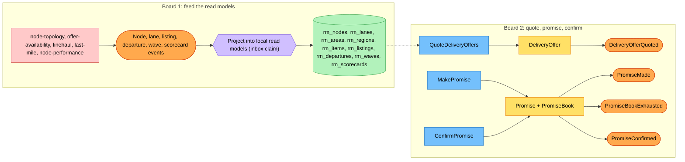
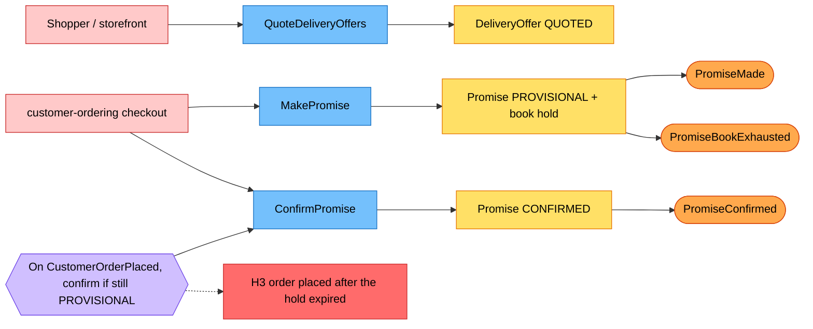
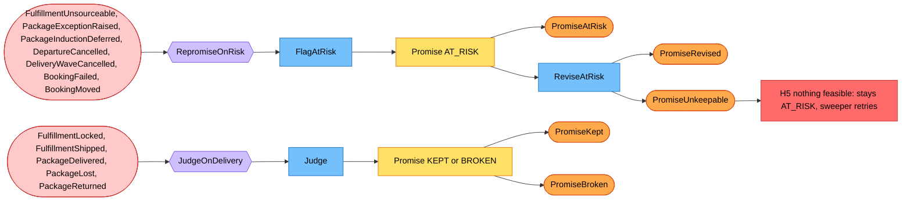
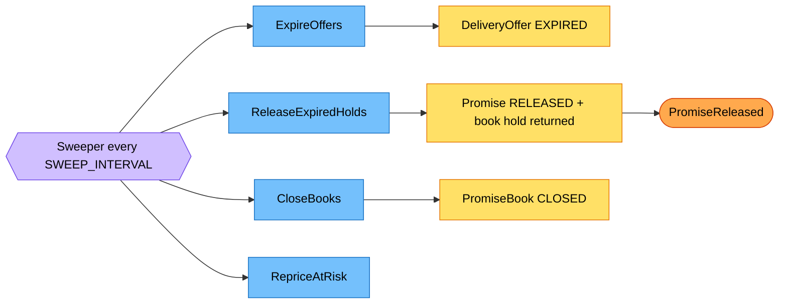

# EventStorming

Process-level boards following the ddd-crew [EventStorming glossary](https://github.com/ddd-crew/eventstorming-glossary-cheat-sheet): orange **events**, blue **commands**, lilac **policies**, yellow **aggregates**, green **read models**, pink **external systems**, red **hotspots**. They are drawn from the code on this branch; the command, policy and event names are the use-case and event names of `internal/application/usecases`.

## Board 1: feed the read models

Every consumed topic has one handler per type (`Handlers`). A handler claims the CloudEvents `id` in `processed_events` and writes one `rm_*` row in the same transaction. There is no command and no aggregate here: the owner of the data can overwrite any row.

**Hotspot H1: freshness.** A stale departure or wave row can be quoted; `MakePromise` revalidates the witness path against the current rows and refuses a path that is no longer feasible as `promise-capacity-exhausted`. **Hotspot H2: out-of-order events.** A capacity event can arrive before its schedule event; the projection keeps the remaining count already stored when the schedule event arrives later.

## Board 2: quote, promise, confirm

Hotspot H3: the hold expired before the order was placed. The synchronous confirm in checkout makes a dead promise visible to the caller (`promise-hold-expired`); the reconciling consumer only logs `order placed on a dead promise` and never retries. Hotspot H4: `MakePromise` changes three aggregates (offer, promise, book) in one local transaction: a deliberate exception, because a promise without a hold would break the rule that a promise reserves capacity.

## Board 3: risk, re-promise and judgement

Hotspot H5: a promise that cannot be revised is not broken until a package is judged; `PromiseUnkeepable` is raised once and customer-ordering is expected to cancel the group, which cancels the promise. Hotspot H6: judging needs the assignment (from `FulfillmentLocked`) and the package set (from `FulfillmentShipped`) as well as the delivery; whichever event arrives last triggers the judgement (ADR 0002 A25).

## Board 4: the clock

Source for all boards: `internal/application/usecases/*.go`, `cmd/api/workers.go`, `internal/adapters/inbound/kafka/dispatch.go`.
