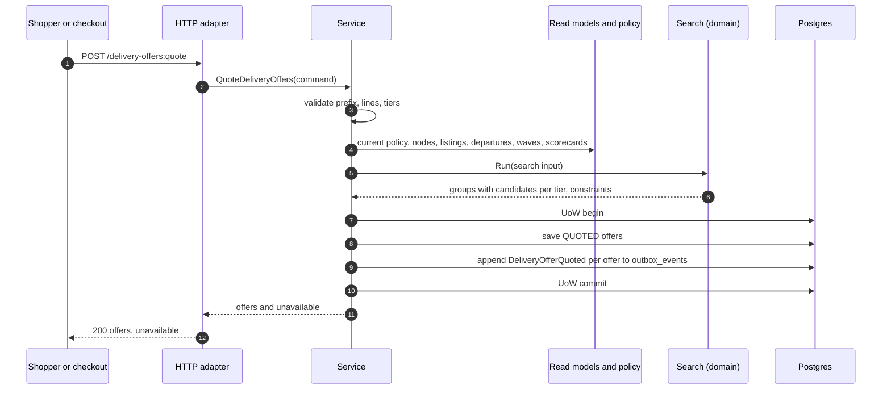
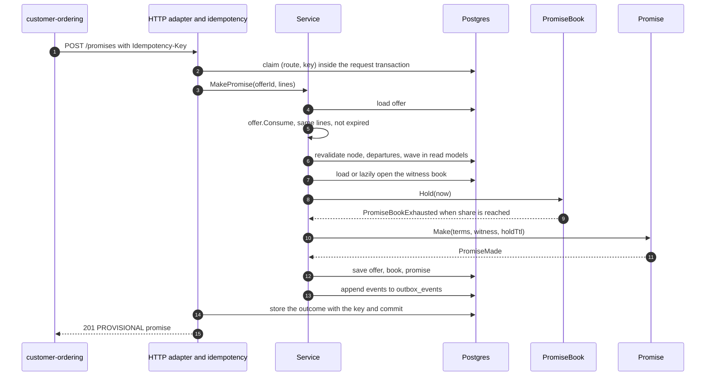
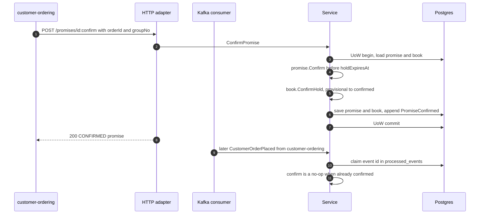
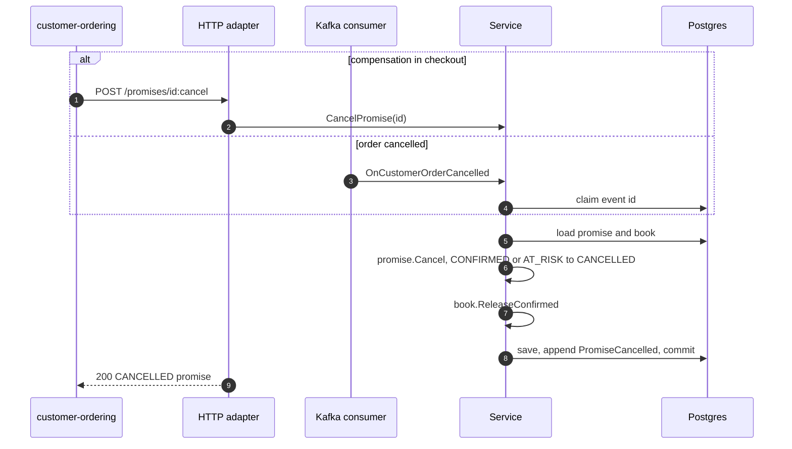
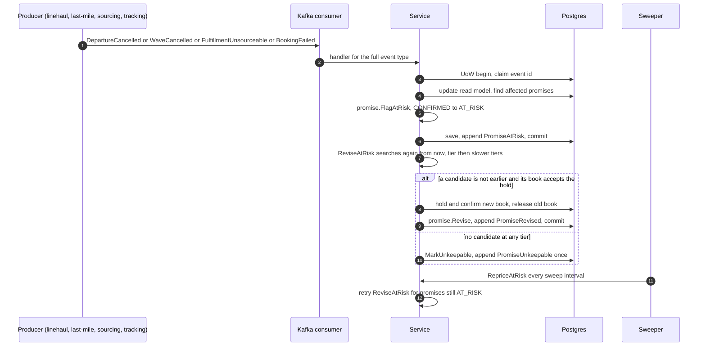
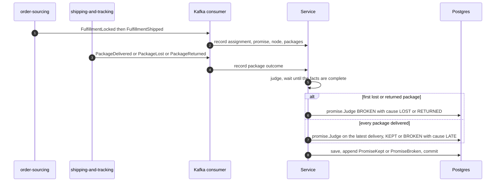
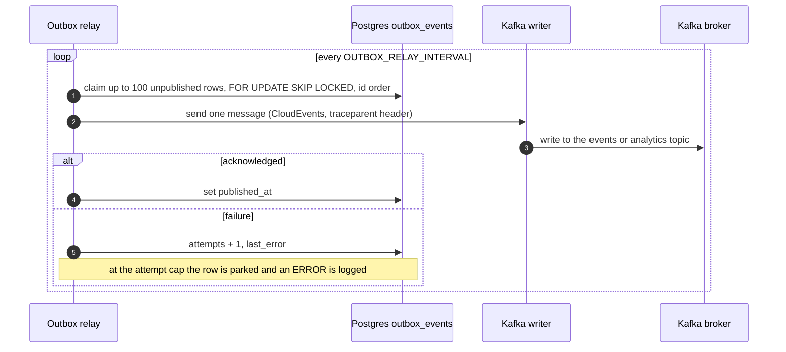
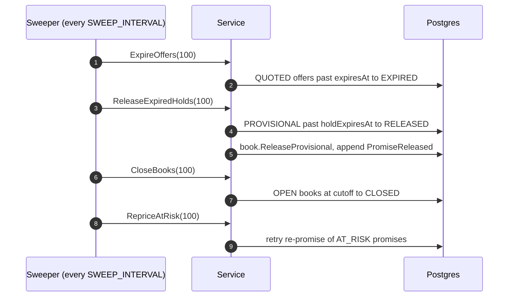
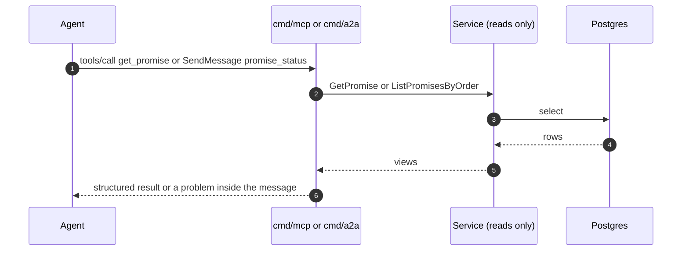

# Sequence diagrams

Each diagram follows one trigger through the hexagon: inbound adapter, `usecases.Service`, aggregates and repositories, outbox. "UoW" is the Postgres unit of work (`ports.UnitOfWork`): everything inside it commits or rolls back together, including the outbox rows.

## Quote

Source: `internal/application/usecases/quote.go`, `internal/domain/search`, `internal/adapters/inbound/http/server.go`.

## Make a promise

Source: `internal/application/usecases/make_promise.go`, `internal/adapters/inbound/http/idempotency.go`. Offer, promise and book change in one transaction: the documented exception to one aggregate per transaction (gap G22).

## Confirm

Source: `internal/application/usecases/lifecycle.go`, `internal/application/usecases/projections.go` (`OnCustomerOrderPlaced`).

## Cancel

Source: `internal/application/usecases/lifecycle.go` (`CancelPromise`, `CancelPromises`, `cancel`).

## Re-promise on risk

Source: `internal/application/usecases/risk.go`, `internal/application/usecases/projections.go`, `cmd/api/workers.go`.

## Judge on delivery

Source: `internal/application/usecases/judge.go`, `internal/application/usecases/projections.go`.

## Outbox relay

Source: `internal/adapters/outbound/outbox/relay.go`, `internal/adapters/outbound/kafka`, `cmd/api/workers.go`.

## Sweeper

Source: `cmd/api/workers.go` (`sweepOnce`), `internal/application/usecases/lifecycle.go`, `internal/application/usecases/risk.go`.

## Read through MCP or A2A

Source: `internal/adapters/inbound/mcp`, `internal/adapters/inbound/a2a/skills.go`, `cmd/mcp/main.go`, `cmd/a2a/main.go`. Neither binary can write: their `Reads` interface has no write method.
