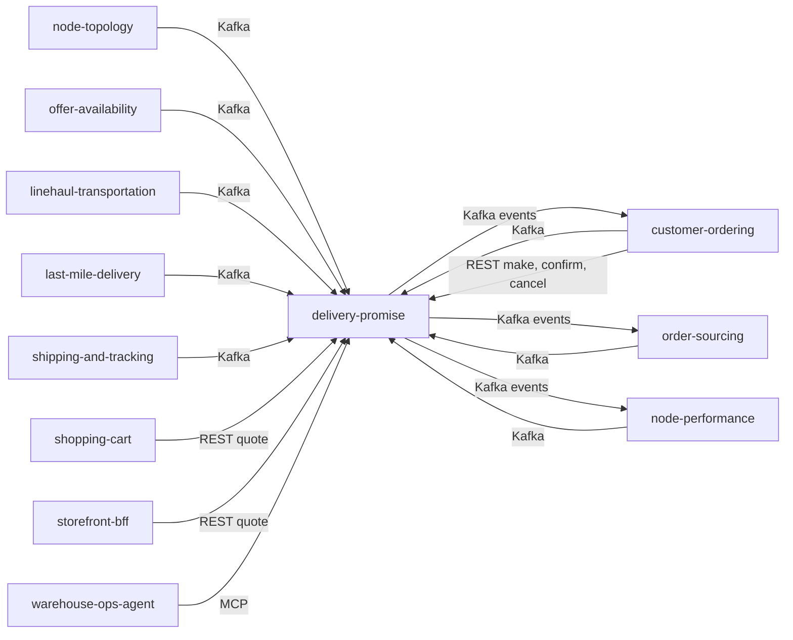

# Integration

How Delivery Promise fits with the retail network and the platform, with the **status of every edge**. Three words are used strictly:

- **Built**: code on this repository's branch that does the job.
- **Verified**: the other side was read on its own `origin/develop` (customer-ordering, shopping-cart, storefront-bff, order-sourcing, node-performance and `warehouse-infra`, read 2026-10-31) and matches.
- **Absent**: no code on either side.

The repository's own rule (`CLAUDE.md`): the service **calls no sibling**. Every input of the promise hot path is a local read model fed by events, so a neighbour that is down slows freshness, not quotes. It reads no `warehouse.*` topic and calls no warehouse-systems fleet service.

## Edge map

Source: `internal/adapters/inbound/kafka/dispatch.go`, `internal/adapters/outbound/kafka/encoder.go`, `apis/asyncapi.yaml`, `apis/openapi.yaml`, and the consumers' own code on their `origin/develop`.

## Upstream: what Delivery Promise consumes

One consumer (`cmd/api`, group `DELIVERY_PROMISE_CONSUMER_GROUP`, `delivery-promise-consumer` in the cluster) reads eight topics. Dispatch is on the full CloudEvents `type`; the 34 handled types are in `Handlers` (`internal/adapters/inbound/kafka/dispatch.go`).

| Producer | Topic | Event types (entity) | Built use |
| --- | --- | --- | --- |
| node-topology | `retailnetwork.node-topology.events` | `NodeRegistered`, `NodeOperationalProfileDeclared`, `NodeActivated`, `NodeSuspended`, `NodeRetired` (node); `LaneOpened`, `LaneClosed` (lane); `ServiceAreaAssigned`; `RegionDefined` | read models `rm_nodes`, `rm_lanes`, `rm_areas`, `rm_regions` |
| offer-availability | `retailnetwork.offer-availability.events` | `CatalogItemCreated`, `CatalogItemDiscontinued`, `ListingCreated`, `ListingAvailabilityChanged`, `ListingSuppressed`, `ListingRestored` | `rm_items`, `rm_listings` |
| linehaul-transportation | `retailnetwork.linehaul-transportation.events` | `DepartureScheduled`, `DepartureCapacityChanged`, `DepartureCancelled`, `BookingMoved`, `BookingFailed` | `rm_departures`; cancelled, moved and failed bookings flag promises at risk |
| last-mile-delivery | `retailnetwork.last-mile-delivery.events` | `DeliveryWaveScheduled`, `DeliveryWaveCapacityChanged`, `DeliveryWaveCancelled`, `PackageInductionDeferred` | `rm_waves`; cancellation and deferral flag promises at risk |
| node-performance | `retailnetwork.node-performance.events` | `NodeScorecardUpdated` | `rm_scorecards` (the handicap) |
| order-sourcing | `retailnetwork.order-sourcing.events` | `FulfillmentLocked`, `FulfillmentShipped`, `FulfillmentUnsourceable` | `rm_assignments`, `rm_shipments`; unsourceable flags the promise at risk |
| shipping-and-tracking | `retailnetwork.shipping-and-tracking.events` | `PackageDelivered`, `PackageExceptionRaised`, `PackageLost`, `PackageReturned` | `rm_outcomes`; judging the promise; exceptions flag at risk |
| customer-ordering | `retailnetwork.customer-ordering.events` | `CustomerOrderPlaced`, `CustomerOrderCancelled` | reconciling confirm; cancel |

Types are `com.retailnetwork.<tier>.<producer>.<entity>.<Event>` with tier `logistics`, `commerce` or `partner`; the contracts are restated, never imported, in `apis/asyncapi.yaml` (tolerant local copies: only the fields used are listed, unknown fields are ignored). The producers' own AsyncAPI documents are not re-read by this page's build; ADR 0003 and the `CLAUDE.md` rule require re-reading the producer's spec before changing a consumed shape.

**Failure behaviour of the consumer:** a transient failure (typically Postgres down) is retried up to 5 attempts (200 ms doubling to 5 s) and then published to `<topic>.dlq` with `x-dlq-*` headers; an event of a known type whose payload can never be applied is dead-lettered at once; a message that is not a CloudEvents 1.0 event or has no handler is skipped with a WARN; a redelivered CloudEvents `id` commits nothing (`processed_events`). The offset is committed only after the unit of work committed. A topic that does not exist yet (its producer has not written) only produces consumer retry logs, never unreadiness. See [Troubleshooting](/docs/operations/troubleshooting).

## Downstream: what Delivery Promise publishes

Through the transactional outbox and the always-on relay, at-least-once, key = aggregate root id, stable CloudEvents `id` on retry. Twelve types, full catalogue on [Events](/docs/api-reference/events).

| Topic | Events | Consumers found in code |
| --- | --- | --- |
| `retailnetwork.delivery-promise.events` | `PromiseAtRisk`, `PromiseRevised`, `PromiseKept`, `PromiseBroken`, `PromiseUnkeepable`, `PromiseBookExhausted` | **customer-ordering** (`PromiseAtRisk`, `PromiseRevised`, `PromiseKept`, `PromiseBroken`, `PromiseUnkeepable`; group `customer-ordering-delivery-promise`), **order-sourcing** (`PromiseRevised`, `PromiseBookExhausted`), **node-performance** (`PromiseKept`, `PromiseBroken`). Verified in each repo's `internal/adapters/inbound/kafka/handlers.go` |
| `retailnetwork.delivery-promise.analytics` | `PromiseMade`, `PromiseConfirmed`, `PromiseReleased`, `PromiseCancelled`, `DeliveryOfferQuoted`, `PromisePolicyPublished` | none: published for the record, no consuming context |

Kafka down does not stop writes: events wait in `outbox_events` and publish in `id` order when the broker returns; `/readyz` answers 503 naming kafka meanwhile.

## Synchronous callers (REST, Open Host Service)

Nothing in this service calls out; others call in. All routes are unauthenticated and sit behind Kong at `/api/delivery-promise` (prefix stripped) or the in-cluster Service `delivery-promise.warehouse-systems.svc.cluster.local:80`.

| Caller | Routes it uses | Verified |
| --- | --- | --- |
| customer-ordering (checkout) | `POST /promises`, `POST /promises/{promiseId}/confirmations`, `POST /promises/{promiseId}/cancellations` (compensation); base URL `DELIVERY_PROMISE_URL` | `internal/adapters/outbound/deliverypromise/gateway.go`; infra `deliveryPromiseUrl`. Its default timeout bounds a call, a slow or failing DP is `503 delivery-promise-unavailable` there, and a failed compensating cancel leaves the hold at this service until it expires |
| shopping-cart | `POST /delivery-quotes` only | gateway.go of shopping-cart (`internal/adapters/outbound/deliverypromise`) |
| storefront-bff | `POST /delivery-quotes` only; its fitness test `bff_no_inorg_route_fitness_test.go` forbids `/promises`, `/promise-policies`, `/promise-books` | infra `deliveryPromiseUrl`; `internal/domain/composition/allowlist.go` of storefront-bff |
| checkout | configured with the same base URL (`helm-values/checkout.yaml`) | infra only; the call shape was not read |
| operators, console | `GET` routes through the `web/` remote | `web/` |

The Open Host contract is `apis/openapi.yaml` (see [API reference](/docs/api-reference)); storefront contexts consume only the quote route and never the restricted ones.

## Agents: MCP and A2A

`warehouse-ops-agent` reaches `http://delivery-promise-mcp.warehouse-systems.svc.cluster.local:8090/mcp` (`helm-values/warehouse-ops-agent.yaml`); tools in [MCP tools](/docs/mcp/tools). The A2A agent is deployed (`a2a.enabled` with a Kong route `/api/a2a/delivery-promise`) but **no caller of it was found** in the sibling repositories read for this page. Both are read-only; A2A carries delegation of a goal and never facts.

## Infrastructure wiring

`warehouse-infra` (`helm-values/delivery-promise.yaml`, `develop`): consumer group `delivery-promise-consumer`; secret `delivery-promise-db` with `DATABASE_URL` and `MIGRATIONS_DATABASE_URL`; Kong routes for api, mcp and a2a; the frontend remote served at `/mfes/delivery-promise/`; dashboard `warehouse-delivery-promise` and the alerts listed in [Observability](/docs/operations/observability). Brokers and the Collector endpoint come from `_platform.yaml`. Kafka topics are auto-created by the first writer; the infrastructure declares none.

## Absent edges (on purpose)

- **No synchronous call out**, REST, MCP or A2A, to any sibling; no MCP or A2A client exists (`TestNoOutboundA2AClient`, `TestMCPAdapterDependencyRule`).
- **No `warehouse.*` topic and no warehouse-systems service**: the fleet is one vendor behind the Vendor API, which this context does not use.
- **No edge to `vendor-connectivity` or `seller-inbound`.**
- **No address and no PII**: the context promises to a destination postal prefix; `customer-ordering` holds addresses.
- **No analytics consumer** of the analytics topic.
- **No authentication on any surface**; the in-cluster boundary is the access control.

## Failure behaviour at a glance

| Situation | Behaviour |
| --- | --- |
| Postgres down at boot | migrations and ping retried 5 times (about 15 s), then exit 1 |
| Postgres down at runtime | writes 5xx, `/readyz` 503 naming postgres, consumer retries then dead-letters |
| Kafka down | REST unaffected, `/readyz` 503 naming kafka, relay retries every interval, rows stay in `outbox_events` |
| A producer is silent | read models go stale; quotes use what is known (offers may be refused at `MakePromise` when the witness path no longer holds) |
| A producer sends a malformed payload | dead-lettered at once, partition moves on |
| customer-ordering is down | confirm and cancel calls do not arrive; unconfirmed holds expire and are released by the sweeper |
| Duplicate or replayed event | no effect (inbox) |
