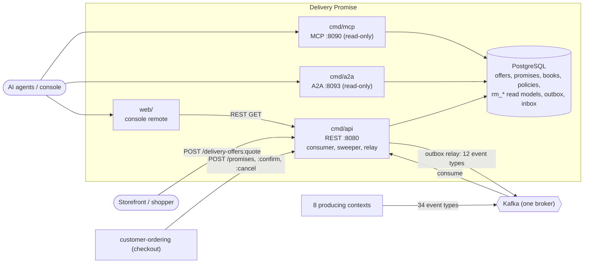

# Architecture

Delivery Promise is a hexagonal (ports and adapters) Go service. Dependencies point inward only, and the rule is an executable test, not a convention: `internal/architecture` (`make arch-test`) fails the build if the domain imports an outer layer or an adapter reaches sideways into its sibling.

## Layout

```text
cmd/api/        composition root: REST adapter, Kafka consumer, sweeper, outbox relay
cmd/mcp/        read-only MCP server (Streamable HTTP, ADR 0007)
cmd/a2a/        read-only A2A agent (JSON-RPC over HTTP, ADR 0010)
internal/
  domain/                 pure business logic, clock and ids passed in
    shared  calendar  policy  offer  book  promise  search
  application/
    ports/ (interfaces only)  readmodel/  repository/  views/  usecases/
  adapters/
    inbound/http/         chi handlers, DTOs, problem+json mapping, readiness, idempotency
    inbound/kafka/        the consumer feeding the local read models
    inbound/mcp/          MCP tools (read-only)
    inbound/a2a/          A2A skills and Agent Card (read-only)
    inbound/requestlog/   access-log middleware shared by the three routers
    kafka/cloudevents/    CloudEvents 1.0 codec, the ONLY envelope builder
    outbound/postgres/    repositories, embedded migrations, unit of work
    outbound/outbox/      transactional outbox relay with attempt cap
    outbound/kafka/       encoder, writer, broker health check
    outbound/telemetry/   OpenTelemetry setup, trace-aware slog handler, business counter
    outbound/clock/ ids/ memory/ repocontract/
  architecture/           fitness tests
  bootretry/              bounded boot retry
  testing/{pgtest,kafkatest}  testcontainers helpers
web/            delivery_promise_mfe, a Module Federation remote for the warehouse console
features/       godog feature files and steps
apis/           openapi.yaml, asyncapi.yaml
charts/         Helm chart (api, mcp, a2a, frontend)
```

- **Domain** (`internal/domain/*`): aggregates `offer`, `promise`, `book`, `policy`, the pure `search` and `calendar`, and `shared` value objects (`Tier`, `Basis`, `Window`, `Witness`, `Line`, domain `Event`). No I/O.
- **Application** (`internal/application`): `usecases.Service` is the one object every inbound adapter drives; `ports` hold the out-port interfaces (`UnitOfWork`, repositories, `NetworkViews`, `ShipmentViews`, `EventOutbox`, `Inbox`, `Clock`, `IDGenerator`, `PromiseMetrics`); `readmodel` and `views` are the shapes read and returned.
- **Adapters:** inbound adapters translate a protocol into one use case; outbound adapters implement the ports. `outbound/memory` and `repocontract` are test doubles and are never linked into a binary (`TestRuntimeBinaryHasNoInMemoryAdapters`).

## Binaries

| Binary | Role | Port | Runs | Needs |
| --- | --- | --- | --- | --- |
| `cmd/api` | REST API (`apis/openapi.yaml`), `/healthz`, `/readyz` | `:8080` (`HTTP_ADDR`) | Kafka consumer (8 topics, 1 group), sweeper (15 s), outbox relay (1 s) | Postgres **and** Kafka |
| `cmd/mcp` | Read-only MCP server, Streamable HTTP on `/mcp` and `/`, `GET /healthz`; five tools | `:8090` (`MCP_ADDR`) | HTTP server only | Postgres |
| `cmd/a2a` | Read-only A2A agent, JSON-RPC 2.0 on `/` and `/a2a`, Agent Card at `/.well-known/agent-card.json`, `GET /healthz`; two skills | `:8093` (`A2A_ADDR`) | HTTP server only | Postgres |

`cmd/mcp` and `cmd/a2a` are independent deployables that wire the **same** `usecases.Service` over the Postgres repositories. Their adapters' `Reads` interface has no write method, so they can never move an aggregate or insert into the outbox, and they never start the relay, consumer or sweeper or dial Kafka. All three run the idempotent embedded migrations at boot (golang-migrate's advisory lock makes concurrent starts safe). The `web/` remote is served by its own nginx pod and calls the REST GETs through the console shell.

All three routers use the same middleware order (the fleet observability standard): request id, otelchi server span, request-duration histogram, access log, recoverer. None adds authentication; REST, MCP and A2A are unauthenticated and rely on the in-cluster boundary (`TestNoAuthMiddlewareReintroduced`).

## Container diagram



Source: `cmd/api/main.go`, `cmd/api/workers.go`, `cmd/mcp/main.go`, `cmd/a2a/main.go`, `charts/delivery-promise/values.yaml`.

## Data stores

One PostgreSQL database, owned by `cmd/api` and shared read-only by `cmd/mcp` and `cmd/a2a`. Migrations: `internal/adapters/outbound/postgres/migrations/0001_delivery_promise_schema` and `0002_window_time_zone`.

| Table(s) | Holds |
| --- | --- |
| `delivery_offers`, `promises`, `promise_books`, `promise_policies` | the four aggregates, each stored as a jsonb snapshot (`Restore()` validates it on read) with queryable columns beside it; `promises` and `promise_books` carry a `version` for optimistic concurrency |
| `outbox_events` | events written in the same transaction as the aggregates; `published_at`, `attempts`, `last_error` drive the relay |
| `processed_events` | the inbox: the CloudEvents `id` of every consumed event, claimed in the same transaction as its effect |
| `idempotency_keys` | stored outcome of each `(route, Idempotency-Key)`, purged after 24 hours |
| `rm_nodes`, `rm_lanes`, `rm_areas` (service areas by postal prefix), `rm_regions`, `rm_items` (catalogue items), `rm_listings`, `rm_departures`, `rm_waves`, `rm_scorecards` | local read models kept from consumed events, one jsonb row per entity: topology, availability, schedules, waves, handicaps |
| `rm_assignments` (assignment to promise), `rm_shipments` (packages of an assignment), `rm_trackings` (tracking number to assignment), `rm_outcomes` (delivered, lost or returned per package) | the shipment facts needed to find a promise's assignment and judge it |

There is no cache, no search index and no other store. Kafka holds the two published topics, the eight consumed topics and the `<topic>.dlq` dead-letter topics; nothing else is written outside Postgres and Kafka.

## Key flows

- **Quote:** adapter to `QuoteDeliveryOffers`, which reads policy and `rm_*` and persists offers. No outbound call.
- **Promise:** `MakePromise` consumes the offer, creates the promise and holds the book in one transaction (the documented exception, gap G22), then appends `PromiseMade` to the outbox.
- **Publish:** the relay claims unpublished `outbox_events` rows with `FOR UPDATE SKIP LOCKED`, encodes CloudEvents 1.0 and sends them one at a time in `id` order; a row that fails 20 times is parked.
- **Consume:** one message at a time, offset committed only after the unit of work committed; transient failures retry, impossible payloads go to `<topic>.dlq`.

See [Runtime](/docs/overview/runtime) for boot and shutdown order, [Sequence diagrams](/docs/ddd/sequence-diagrams) for the interactions and [ADR 0006](/docs/adr/0006-http-adapter-consumer-and-readiness) for the decisions.
